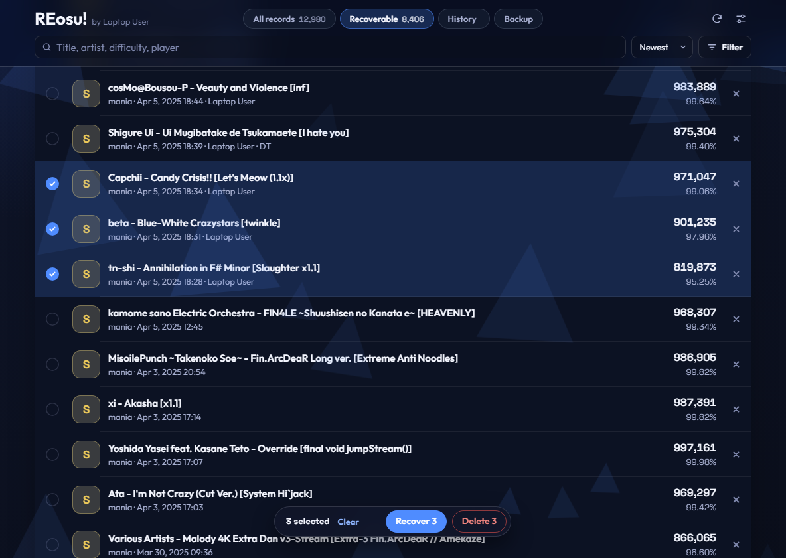
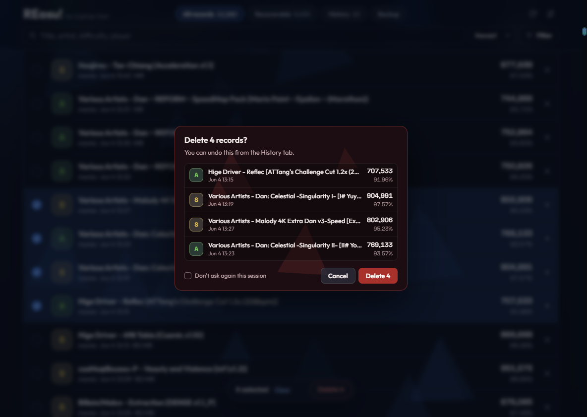
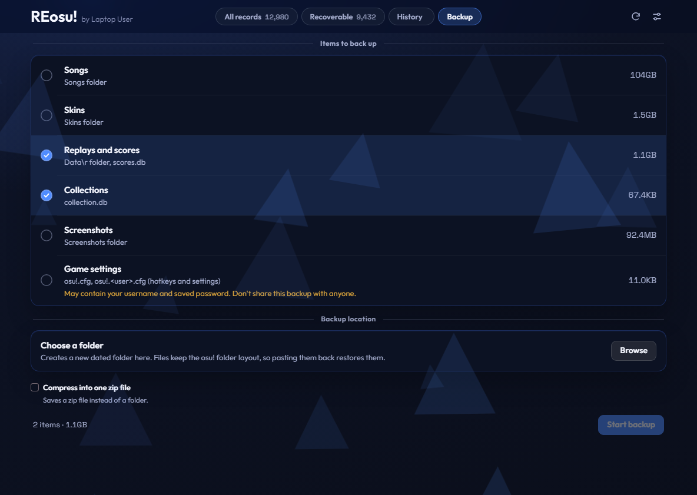

<picture>
  <source media="(prefers-color-scheme: dark)" srcset="docs/logo/logo-dark.png">
  
</picture>

[English](README.md) | [한국어](README.ko.md) | [简体中文](README.zh-CN.md) | **日本語**

Windows 版 **osu!stable** のローカル記録管理ツールです。ローカルランキングから消えた記録を見つけ、リプレイファイルから復元します。記録の閲覧や削除、osu! フォルダーのバックアップもできます。

ppy とは関係のない非公式ツールです。

## ダウンロード

[最新リリース](https://github.com/Asaua/REosu/releases/latest)から `REosu.exe` をダウンロードして実行してください。インストールは不要です。

この exe にはコード署名がないため、Windows SmartScreen の警告が出ることがあります。**詳細情報**を押してから**実行**を選んでください。リリースページの SHA-256 値でファイルを照合できます。

## スクリーンショット







## 機能

- **復元：** `Data\r` にあって `scores.db` にないリプレイを一覧にし、選んだ記録を復元します。
- **すべての記録：** ローカル記録の閲覧、絞り込み、削除ができます。
- **履歴：** 復元と削除を取り消せます。削除したリプレイは既定で `Data\r\_deleted` に保管します。
- **バックアップ：** リプレイ、コレクション、楽曲、スキン、スクリーンショット、設定を日付付きのフォルダーにコピーします。
- **言語：** 韓国語、英語、簡体字中国語、日本語に対応しています。

## 変更するファイル

変更は osu! が閉じているときだけ実行します。osu! の起動中は待機リストに入れ、終了後に実行します。

| ファイル | 変更内容 |
|---|---|
| `scores.db` | 選んだ記録を追加または削除します |
| `Data\r` | 削除した記録のリプレイを保管フォルダーに移動します |
| `osu!.db` | 記録が変わった譜面のランクアイコンと最終プレイ日時だけを更新します |

バックアップ項目の `osu!.cfg` には、ユーザー名と保存されたパスワードが含まれている場合があります。この項目を含むバックアップは他の人と共有しないでください。

## ネットワーク

オフラインで動作します。未インストールの譜面を検索するときだけ、その譜面のハッシュを [osu.direct](https://osu.direct) に送信し、失敗した場合は [catboy.best](https://catboy.best) に送信します。

## ソースから実行

Python と [pywebview](https://pywebview.flowrl.com) が必要です。pywebview または WebView2 ランタイムがない場合は、既定のブラウザーで開きます。

```bash
pip install pywebview
python osu_score_recovery.py
```

## ビルド

```bash
pip install pyinstaller pywebview
pyinstaller --onefile --noconsole --name REosu --icon icon.ico --add-data "web;web" osu_score_recovery.py
```

## クレジット

- 画面のスタイルは [osumania_map_analyser](https://github.com/LeoBlackMT/osumania_map_analyser)（MIT）を参考にしました。
- フォント：[Outfit](https://github.com/Outfitio/Outfit-Fonts)、[Space Grotesk](https://github.com/floriankarsten/space-grotesk)（SIL Open Font License）。詳しくは `web/fonts` をご覧ください。
