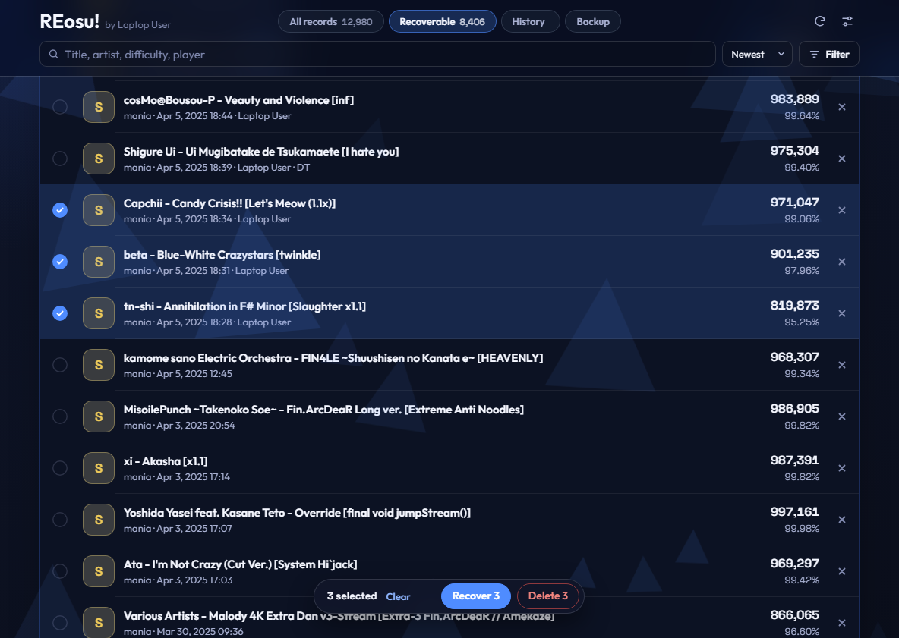
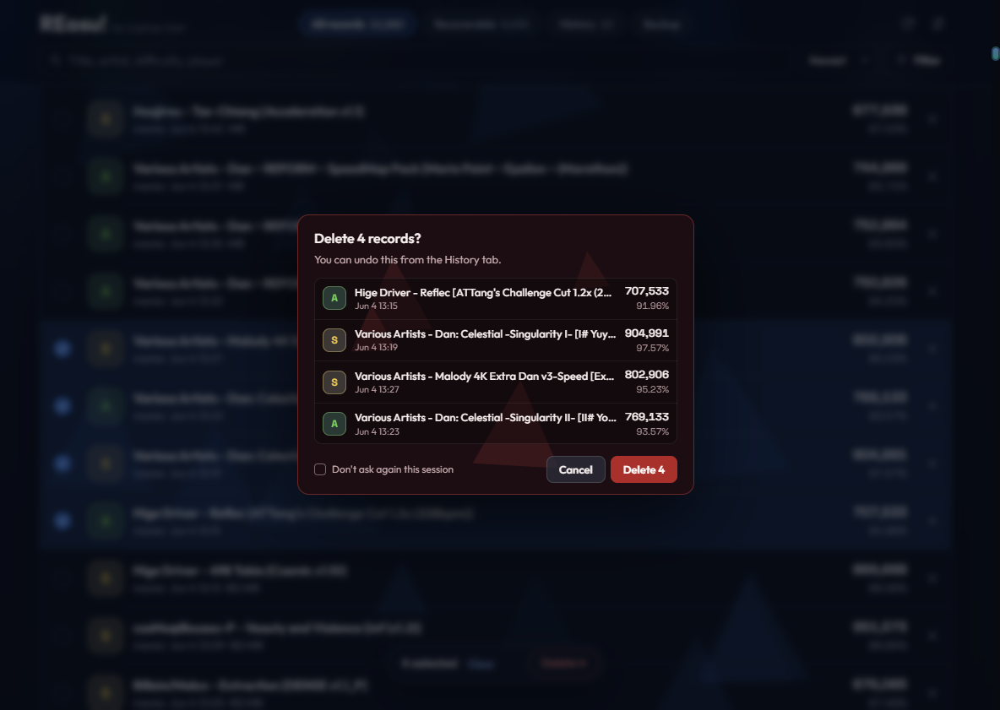
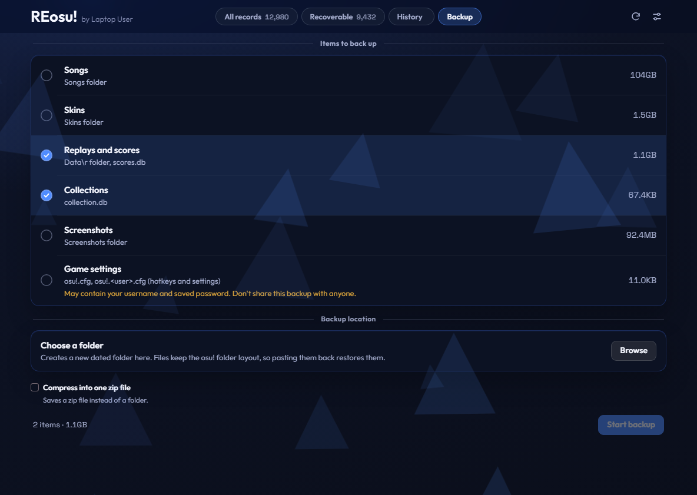

<picture>
  <source media="(prefers-color-scheme: dark)" srcset="docs/logo/logo-dark.png">
  
</picture>

[English](README.md) | **한국어** | [简体中文](README.zh-CN.md) | [日本語](README.ja.md)

Windows용 **osu!stable** 로컬 기록 관리 도구입니다. 로컬 랭킹에서 사라진 기록을 찾아 리플레이 파일로 되살립니다. 기록을 살펴보거나 삭제할 수 있고, osu! 폴더도 백업할 수 있습니다.

ppy와는 관계없는 비공식 도구입니다.

## 다운로드

[최신 릴리스](https://github.com/Asaua/REosu/releases/latest)에서 `REosu.exe`를 받아 실행하면 됩니다. 설치는 필요 없습니다.

코드 서명이 없는 exe라서 Windows SmartScreen이 경고할 수 있습니다. **추가 정보**를 누른 뒤 **실행**을 고르세요. 릴리스 페이지의 SHA-256 값으로 파일을 대조할 수 있습니다.

## 스크린샷







## 기능

- **복구:** `Data\r`에는 있지만 `scores.db`에 없는 리플레이를 나열하고, 선택한 기록을 되살립니다.
- **전체 기록:** 로컬 기록을 살펴보고, 필터로 찾고, 삭제합니다.
- **내역:** 복구와 삭제를 되돌립니다. 삭제한 리플레이는 기본적으로 `Data\r\_deleted`에 보관합니다.
- **백업:** 리플레이, 컬렉션, 곡, 스킨, 스크린샷, 설정을 날짜가 붙은 폴더에 복사합니다.
- **언어:** 한국어, 영어, 중국어 간체, 일본어를 지원합니다.

## 변경하는 파일

변경은 osu!가 꺼져 있을 때만 실행합니다. osu!가 켜져 있으면 대기열에 넣었다가 종료한 뒤 실행합니다.

| 파일 | 변경 내용 |
|---|---|
| `scores.db` | 선택한 기록을 넣거나 뺍니다 |
| `Data\r` | 삭제한 기록의 리플레이를 보관 폴더로 옮깁니다 |
| `osu!.db` | 기록이 바뀐 맵의 등급 아이콘과 마지막 플레이 시각만 고칩니다 |

백업 항목의 `osu!.cfg`에는 아이디와 저장된 비밀번호가 들어 있을 수 있습니다. 이 항목을 포함한 백업은 다른 사람과 공유하지 마세요.

## 인터넷 사용

인터넷 없이도 동작합니다. 설치되지 않은 맵의 정보를 조회할 때만 그 맵의 해시를 [osu.direct](https://osu.direct)로 보내고, 실패하면 [catboy.best](https://catboy.best)로 보냅니다.

## 소스에서 실행

Python과 [pywebview](https://pywebview.flowrl.com)가 필요합니다. pywebview나 WebView2 런타임이 없으면 기본 브라우저로 열립니다.

```bash
pip install pywebview
python osu_score_recovery.py
```

## 빌드

```bash
pip install pyinstaller pywebview
pyinstaller --onefile --noconsole --name REosu --icon icon.ico --add-data "web;web" osu_score_recovery.py
```

## 크레딧

- 화면 스타일은 [osumania_map_analyser](https://github.com/LeoBlackMT/osumania_map_analyser)(MIT)를 참고했습니다.
- 폰트: [Outfit](https://github.com/Outfitio/Outfit-Fonts), [Space Grotesk](https://github.com/floriankarsten/space-grotesk) (SIL Open Font License). `web/fonts`를 참고하세요.
