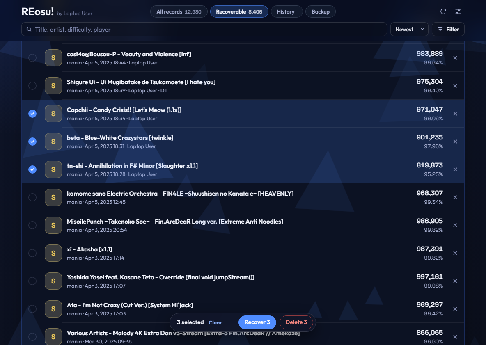
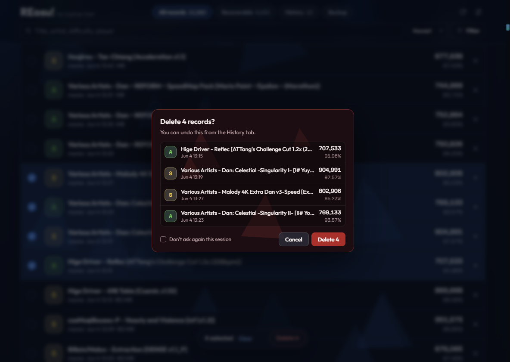
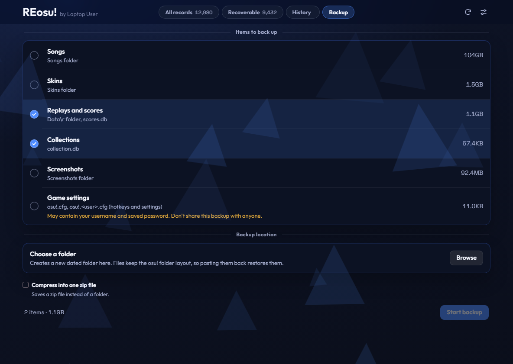

<picture>
  <source media="(prefers-color-scheme: dark)" srcset="docs/logo/logo-dark.png">
  
</picture>

**English** | [한국어](README.ko.md) | [简体中文](README.zh-CN.md) | [日本語](README.ja.md)

A local record manager for **osu!stable** on Windows. It finds records that disappeared from the local leaderboard and brings them back from the replay files. You can also browse and delete records and back up your osu! folders.

Not affiliated with or endorsed by ppy.

## Download

Get `REosu.exe` from the [latest release](https://github.com/Asaua/REosu/releases/latest) and run it. No installation is needed.

The exe is self-signed by Asaua, not by a certificate authority Windows trusts, so Windows SmartScreen may warn you. Choose **More info**, then **Run anyway**. You can compare the file with the SHA-256 hash on the release page.

## Screenshots







## Features

- **Recover:** lists replays in `Data\r` that are missing from `scores.db`, and restores the ones you select. The map must be installed.
- **All records:** browse, filter, and delete local records.
- **History:** undo any recovery or deletion. Deleted replays are kept in `Data\r\_deleted` by default.
- **Backup:** copy replays, collections, songs, skins, screenshots, and settings to a dated folder.
- **Languages:** Korean, English, Simplified Chinese, and Japanese.

## What it changes

Changes run only while osu! is closed. If osu! is running, they wait in a queue until you close it.

| File | Change |
|---|---|
| `scores.db` | Adds or removes the selected records |
| `Data\r` | Moves the replays of deleted records to the trash folder |
| `osu!.db` | Updates the map's grade icon and last played time, only for maps whose records changed |

The backup item for `osu!.cfg` may contain your username and saved password. Don't share a backup that includes it.

## Network

The tool works offline. Looking up a map that isn't installed sends only that map's hash to [osu.direct](https://osu.direct), or to [catboy.best](https://catboy.best) as a fallback.

## Run from source

Requires Python and [pywebview](https://pywebview.flowrl.com). Without pywebview or the WebView2 runtime, the page opens in your default browser.

```bash
pip install pywebview
python osu_score_recovery.py
```

## Build

```bash
pip install pyinstaller pywebview
pyinstaller --onefile --noconsole --name REosu --icon icon.ico --add-data "web;web" osu_score_recovery.py
```

## License

[MIT](LICENSE). The fonts in `web/fonts` keep their own license.

## Credits

- Visual style inspired by [osumania_map_analyser](https://github.com/LeoBlackMT/osumania_map_analyser) (MIT).
- Fonts: [Outfit](https://github.com/Outfitio/Outfit-Fonts) and [Space Grotesk](https://github.com/floriankarsten/space-grotesk), under the SIL Open Font License. See `web/fonts`.
