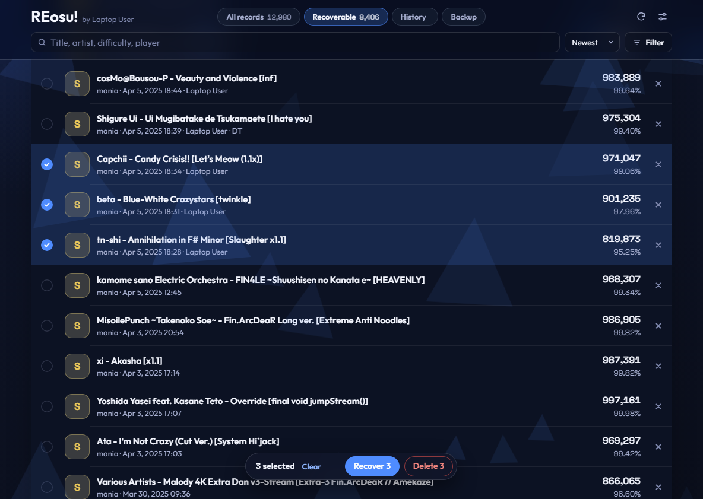
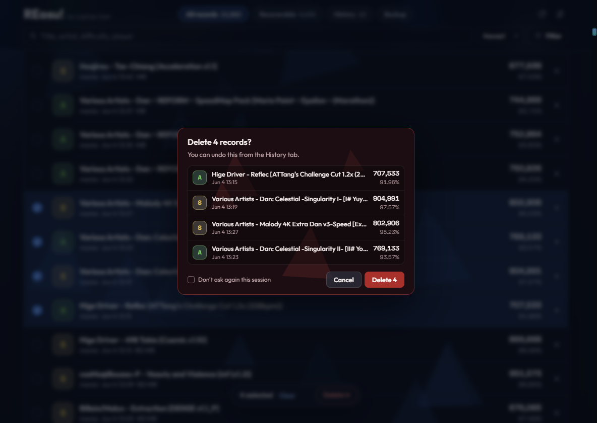
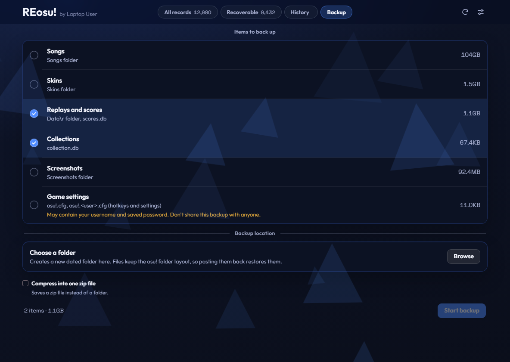

<picture>
  <source media="(prefers-color-scheme: dark)" srcset="docs/logo/logo-dark.png">
  
</picture>

[English](README.md) | [한국어](README.ko.md) | **简体中文** | [日本語](README.ja.md)

适用于 Windows 版 **osu!stable** 的本地记录管理工具。它能找到从本地排行中消失的记录，并通过回放文件恢复。你还可以浏览和删除记录，以及备份 osu! 文件夹。

本工具为非官方工具，与 ppy 无关。

## 下载

从[最新版本](https://github.com/Asaua/REosu/releases/latest)下载 `REosu.exe` 并运行即可，无需安装。

此 exe 由 Asaua 自签名，并非 Windows 信任的证书机构签发，因此 Windows SmartScreen 可能会发出警告。请点击**更多信息**，然后点击**仍要运行**。你可以用发布页面上的 SHA-256 值核对文件。

## 截图







## 功能

- **恢复：** 列出 `Data\r` 中存在但 `scores.db` 中缺失的回放，并恢复你选择的记录。需要已安装对应谱面。
- **全部记录：** 浏览、筛选和删除本地记录。
- **历史：** 撤销恢复和删除操作。已删除的回放默认保存在 `Data\r\_deleted` 中。
- **备份：** 将回放、收藏夹、歌曲、皮肤、截图和设置复制到带日期的文件夹。
- **语言：** 支持韩语、英语、简体中文和日语。

## 会修改的文件

修改只在 osu! 关闭时执行。如果 osu! 正在运行，操作会进入队列，等它关闭后再执行。

| 文件 | 修改内容 |
|---|---|
| `scores.db` | 添加或移除所选记录 |
| `Data\r` | 将已删除记录的回放移到保存文件夹 |
| `osu!.db` | 只更新记录发生变化的谱面的等级图标和最后游玩时间 |

备份项中的 `osu!.cfg` 可能包含你的用户名和已保存的密码。请勿分享包含此项的备份。

## 网络使用

本工具可以离线使用。只有在查询未安装的谱面时，才会将该谱面的哈希发送到 [osu.direct](https://osu.direct)，失败时改用 [catboy.best](https://catboy.best)。

## 从源码运行

需要 Python 和 [pywebview](https://pywebview.flowrl.com)。如果没有 pywebview 或 WebView2 运行时，页面会在默认浏览器中打开。

```bash
pip install pywebview
python osu_score_recovery.py
```

## 构建

```bash
pip install pyinstaller pywebview
pyinstaller --onefile --noconsole --name REosu --icon icon.ico --add-data "web;web" osu_score_recovery.py
```

## 许可证

[MIT](LICENSE)。`web/fonts` 中的字体遵循各自的许可证。

## 致谢

- 界面风格参考了 [osumania_map_analyser](https://github.com/LeoBlackMT/osumania_map_analyser)（MIT）。
- 字体：[Outfit](https://github.com/Outfitio/Outfit-Fonts) 和 [Space Grotesk](https://github.com/floriankarsten/space-grotesk)（SIL Open Font License）。详见 `web/fonts`。
